<a href="https://stayza.pk/founder">The founder story</a> · <a href="assets/film.mp4">30 second film</a>

<h2 align="center">Selected work</h2>

<h2 align="center">Stack</h2>

<table>
<tr><td><b>Languages</b></td><td>Python · Java · TypeScript · SQL · C++ · JavaScript · HTML · CSS</td></tr>
<tr><td><b>Frontend</b></td><td>React · Tailwind CSS · Flutter · Tauri · JavaFX · Java Swing · shadcn/ui · Framer Motion</td></tr>
<tr><td><b>Backend</b></td><td>FastAPI · Supabase · Hibernate · Node.js · REST APIs · Supabase Auth</td></tr>
<tr><td><b>Databases</b></td><td>PostgreSQL · MariaDB · SQLite · Firebase · MySQL</td></tr>
<tr><td><b>Tools</b></td><td>Vercel · Resend · Git · GitHub · VS Code · Figma · Vite · npm · Linux · Maven · XAMPP</td></tr>
<tr><td><b>Learning</b></td><td>System design · Distributed systems · Cloud deployment · Software architecture · Design patterns · AI</td></tr>
</table>

<h2 align="center">Right now</h2>

Iterating on **Stayza** with real users · studying system design and cloud deployment · open to internships and collaborations · also building [course-file-organizer](https://github.com/rehmanoncloud9/course-file-organizer) and [CarRent](https://github.com/rehmanoncloud9/CarRent)

Google Antigravity National Hackathon (AI Seekho 2026) · Leadership Training, Punjab Boy Scouts Association

 

